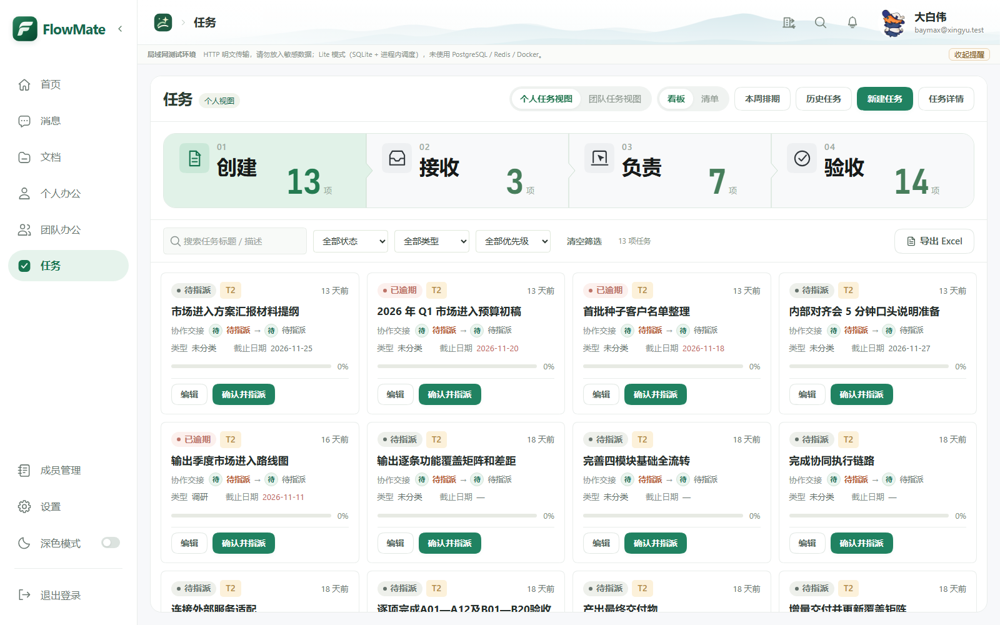
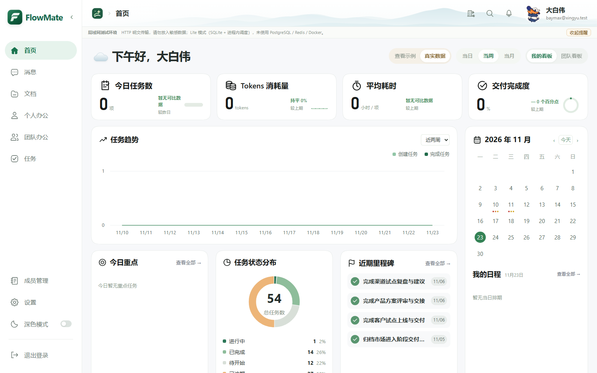
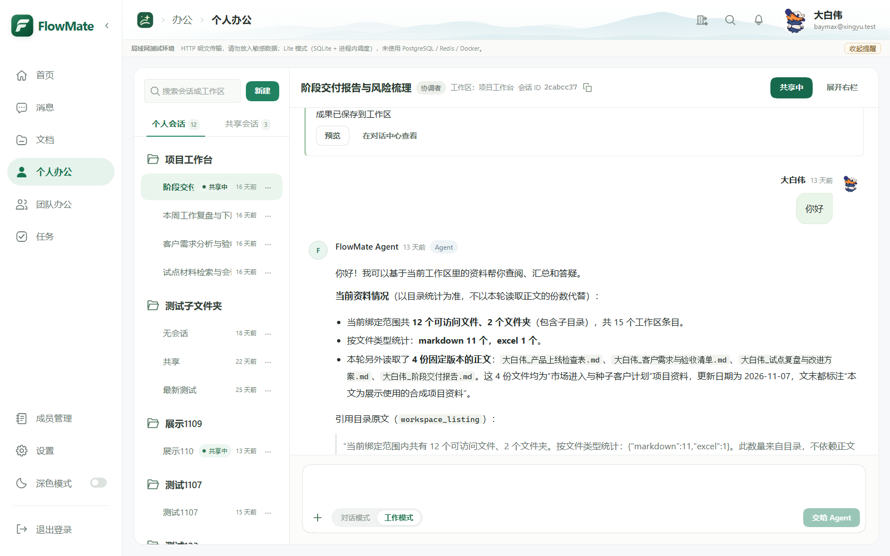

# FlowMate · 面向协作的 AI 办公平台

**把「任务工作流 / 可协作的 Agent / 看板」做成一条链路的 AI 办公平台。**
任务按固定流程流转，Agent 在流程内被多人协作调用，看板让所有产出可见——不是三个各做各的功能页。

React 19 · NestJS 11 · Node 内置 SQLite（FTS5）· 一条命令本地起服务，不需要 Docker / PostgreSQL / Redis



---

## 它解决什么问题

团队里任务、AI 助手、进度看板常常是三套割裂的东西：

- 任务在群里口头派，**没有状态机**，谁在等谁全靠问；
- AI 只在个人对话框里产出一次性内容，**进不了团队流程**，也没法被同事复核；
- 看板靠人手工填，**和真实数据对不上**，最后没人看。

FlowMate 的判断是：这三件事必须共用一套数据与权限模型。于是它只有一个真相来源——任务的每一次流转、Agent 的每一次读写、看板的每一个数字，都来自同一批表。

## 三个核心能力

### 1. 任务工作流：四段式、有状态、可追责

`创建 → 接收 → 负责 → 验收` 四段各自独立计数，任务按「创建人 →（1–5 位经手人）→ 交付人」的链路流转：

- **接收**必须填预估时长，可接收 / 调整 / 退回；
- **负责**支持手动排期与**容量感知的自动排期**（按预估时长 + 优先级 + 期限排进本周，不排过去、不晚于期限、不重叠）；
- **验收**通过或重新指派，`completed` 只能由验收动作产生；
- 14 个状态动作每个都在服务端校验前置状态与操作人权限——非法流转靠接口拒绝，不靠前端藏按钮。



### 2. 可协作的 Agent：写入只能落草稿，改正式文件要多人点头

Agent 的权限被拆成**工具分级 + 提案闸门**：

- **7 个只读工具**（列目录 / 读文件 / 抽正文 / 搜内容 / 读图 / 读历史 / 读任务），每步留痕；
- **6 个写入工具**（建草稿 / 写改草稿 / 建目录 / 写版本 / 产物落盘），**正式文件只能在草稿区改**；
- 要改正式文件 → 生成提案 → **N 人共同确认**：`0/N → N/N` 期间文件字节不变，全部同意才写入且只写一次；
- 不表态就 1 小时提醒、72 小时转「已搁置」（**绝不自动通过**），基准变了转 stale 重审；
- 会话可共享给同事**只读**参与（可选历史范围与有效期），也可建团队分支双方同页输入；
- 每个会话 2 个执行槽，租约 + fencing token 防止两个 Run 重复写入。



### 3. 看板：我的 / 团队 × 日 / 周 / 月，与任务同源

四张指标卡（今日任务数、Token 消耗量、平均耗时、交付完成度）+ 任务趋势、今日重点、状态分布、工作日历、团队负荷表。**看板不维护第二套真相**，数字全部从任务与会话表实时算出。

## 30 秒跑起来

前置只有一个：**Node.js ≥ 24**（用到内置 SQLite，不装数据库、不用 Docker）。

```bash
pnpm install
pnpm start
```

打开 **http://localhost:8080**，用下面任一账号登录（邮箱 + 统一密码 `abc123`）：

| 登录名 | 邮箱 | 身份 |
| --- | --- | --- |
| 大白伟 | `baymax@xingyu.test` | 负责人，全权限 |
| 虎牙 | `hy123@xingyu.test` | 产品总监 |
| 陈奕迅 | `cyx666@xingyu.test` | 设计总监 |
| 许杨天 | `xuyangtian@xingyu.test` | 技术总监（不在产品/设计团队，用来试权限被拒） |

- **装依赖报 `ERR_PNPM_SYMLINK_FAILED`？** 说明当前 Windows 账户没有创建符号链接的权限。仓库根目录已放 `.npmrc`（`node-linker=hoisted`），默认就是平铺安装；手动补一条 `pnpm install --config.node-linker=hoisted` 即可。
- **想局域网给同事看**：服务监听 `0.0.0.0:8080`，对方打开 `http://<你的内网IP>:8080`。
- **要完整演示数据**：`pnpm run seed:reset`（清空重灌，必须带这个参数，平时不会误触）。
- **没有模型密钥也能跑**：Agent 计划由内置确定性规划器产出，界面如实标注 `planner=deterministic`；需要模型的能力（读文件回答、纪要提取）会明确返回 503，**不会拿预制结果冒充成功**。

要接真实模型，把 `.env.example` 复制成 `.env` 填三项：

```
MODEL_BASE_URL=https://api.deepseek.com
MODEL_API_KEY=<你的密钥>
MODEL_NAME=<模型名>
```

密钥只在后端读取，不进前端包、不进日志、不进模型上下文。

## 技术取舍：三处替换，四条底线没松

目标机器没有 Docker、没有 PostgreSQL、没有 Redis，只有 2–3 人局域网。为了「`pnpm install` 之后一条命令就能跑」，做了三处替换，但**语义都保住了**：

| 规格原本 | 本项目落地 | 保住了什么 |
| --- | --- | --- |
| PostgreSQL 16/17 + tsvector | `node:sqlite` + FTS5 + 中文二元组索引 | 真 SQL、真事务、真外键、真倒排索引，中文可按正文检索 |
| Redis + BullMQ | 进程内调度器 `server/core/queue.ts` | 命名队列并发上限、租约、fencing token、退避重试、重启从库恢复 |
| Docker Compose | 单进程 `pnpm start`（API 托管前端 + Worker 同进程） | 局域网 2–3 人够用，界面常驻「Lite 模式」说明 |

**没有为省事放松的四条底线**（每条都有自动化断言）：

1. 服务端鉴权——会话权 / 目录权 / 动作权分别校验，前端只做展示；
2. 路径不越界——canonical 路径 + 工具绑定校验，越界动作留 `denied` 痕迹；
3. 正式文件写入必须过共同确认；
4. 幂等与版本冲突检测——`Idempotency-Key`、`client_msg_id`、`base_version`、审批唯一索引。

## 验证

```bash
pnpm typecheck   # 前后端类型检查，0 错误
pnpm test        # 核心不变量单测
pnpm verify      # 11 套回归（含端到端主链路、时序挂起、SSR 渲染）
```

`pnpm verify` 默认打 8090 验证实例并**拒绝指向 8080**，避免测试数据写进你正在用的库。当前 11 套断言通过 326 条，3 条已知落后于现行文案（详见 [docs/测试报告.md](docs/测试报告.md) 与《快速开始.md》），**这三条是断言没跟上，不是功能坏了**，没有靠改断言凑绿。

覆盖情况按产品文档 §00–§26 逐条核对，见 [docs/功能覆盖表.md](docs/功能覆盖表.md)：61 条需求点、52 条已实现并有验证证据、11 项明确裁剪。

## 目录结构

```
server/core/        配置、DB、鉴权、权限、路径边界、错误契约、调度器、WebSocket
server/adapters/    模型适配器、本地存储、正文抽取（md/txt/html/docx/pdf/xlsx/csv/pptx/图片）
server/modules/     13 个业务模块：auth org files search messages notifications
                    sessions orchestrator proposals tasks discovery center dashboard
db/migrations/      22 个追加式 SQL 迁移
src/                React 19：app 外壳、四个一级模块、UI 原语、设计系统样式
scripts/            seed、backup/restore、dev、出包、自检
tests/              单测 + 端到端 + 各类探针、时序与渲染回归
```

数据与文件：`data/flowmate.sqlite3`（WAL）+ `storage/<前2位>/<uuid>`；`pnpm backup` / `pnpm restore` 做备份与恢复，`data/`、`storage/`、`.env`、`ApiKeys.txt` 都在 `.gitignore` 内。

## 已知边界（不粉饰）

- **局域网双机实测未做**：只有一台机器，但所有断言走 HTTP/WS，换机器重复执行即可；
- **超时挂起的验证方式**：把提醒/挂起时间点改到过去再等真实 tick，不是真等 72 小时；
- **模型厂商专有参数需各自配置**：某些网关要显式关思考，否则思考会吃光输出额度；
- **裁剪项**：OCR、Office 在线编辑、移动端、外部推送、埋点看板等 11 项明确不做，不做静默降级。

## 更多文档

- [快速开始.md](快速开始.md) —— 拿到包之后怎么跑、三分钟走通主链路
- [docs/功能覆盖表.md](docs/功能覆盖表.md) —— 与产品文档逐条对照
- [docs/测试报告.md](docs/测试报告.md) —— 断言清单与问题修复记录
- [docs/交付与分发.md](docs/交付与分发.md) —— 出包、密钥处理、交付前自检

---

本项目是 **2026 千问办公 AI 管理实践挑战赛** 参赛作品的本地可运行版本，代码开源供学习与交流。
